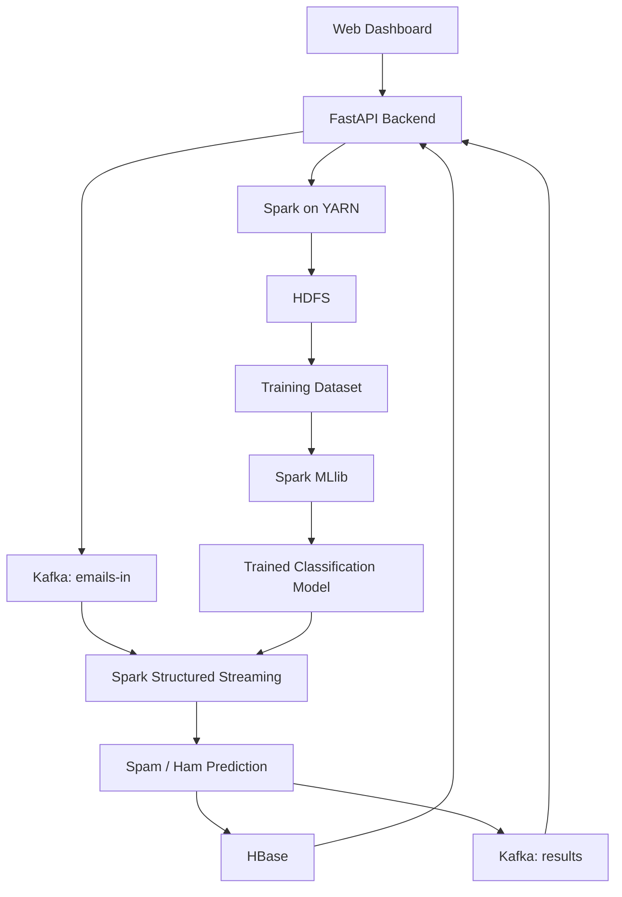
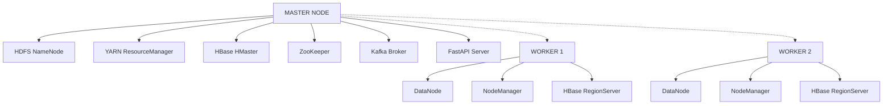

# Distributed Email Spam Classification using Apache Spark MLlib

A distributed Spam/Ham classification system built using Hadoop, Apache Spark MLlib, Kafka, and HBase. The project supports batch model training, real-time email processing, distributed prediction storage, and web-based monitoring.

## Overview

The system combines distributed computing and machine learning to classify incoming messages as Spam or Ham.

- **Hadoop HDFS:** Distributed storage for datasets.
- **Apache Spark MLlib:** Distributed machine learning and model training.
- **Apache Kafka:** Real-time email ingestion.
- **Spark Structured Streaming:** Continuous message processing and classification.
- **Apache HBase:** Storage for predictions and execution logs.
- **FastAPI:** Backend APIs and application integration.
- **HTML, CSS, JavaScript:** Web-based monitoring dashboard.

## System Architecture



## Distributed Cluster Architecture

The project is configured for a three-node cluster consisting of one master and two worker nodes.



| Node | Services |
|---|---|
| Master | NameNode, ResourceManager, HMaster, ZooKeeper, Kafka, FastAPI |
| Worker 1 | DataNode, NodeManager, RegionServer |
| Worker 2 | DataNode, NodeManager, RegionServer |

Kafka uses KRaft mode. ZooKeeper is managed by HBase in this configuration.

## Processing Workflow

### 1. Batch Training


### 2. Real-Time Classification


## Technology Stack

| Technology | Usage |
|---|---|
| Python | Application development |
| Hadoop | Distributed computing ecosystem |
| HDFS | Distributed file storage |
| Apache Spark | Distributed data processing |
| Spark MLlib | Machine learning |
| YARN | Cluster resource management |
| Apache Kafka | Message ingestion |
| Spark Structured Streaming | Real-time processing |
| Apache HBase | Distributed NoSQL storage |
| ZooKeeper | HBase coordination |
| FastAPI | Backend API |
| HTML, CSS, JavaScript | Frontend dashboard |

## Model Performance

Results obtained in local Spark mode using the UCI SMS Spam Collection dataset with an 80:20 train-test split.

**Test samples:** 1,027

### Logistic Regression (Class-Weighted)

| Metric | Target | Result |
|---|---:|---:|
| Accuracy | ≥ 95% | 97.6% |
| False Positive Rate | < 2% | 0.22% |
| Spam F1-Score | ≥ 0.94 | 0.897 |
| Unit Test Coverage | ≥ 80% | 78% |

### Model Comparison

| Model | Accuracy | Spam F1-Score |
|---|---:|---:|
| Logistic Regression | 97.6% | 0.897 |
| Naive Bayes | 96.4% | 0.853 |

**Note:** The Spam F1-score is below the original target. The SMS dataset contains short messages and has an imbalanced class distribution of approximately 13% spam. The original target was intended for larger email datasets such as SpamAssassin and Enron.

### Testing Status

- 27 tests passing locally, as reported by the project test results.
- Core ML, API, and common modules have 76–100% coverage.
- Overall reported test coverage: 78%.
- Distributed Kafka, HDFS, YARN, and HBase integrations still require physical cluster verification.
- Streaming latency and multi-worker performance have not yet been measured.

## Project Structure

```text
spam-classifier/
│
├── cluster/
│   ├── env.sh
│   ├── setup_hadoop.sh
│   ├── setup_spark.sh
│   ├── setup_kafka.sh
│   ├── setup_hbase.sh
│   ├── start_all.sh
│   ├── stop_all.sh
│   └── health_check.sh
│
├── config/
│   ├── cluster.yaml
│   └── settings.yaml
│
├── data/
│   ├── raw/
│   └── sample/
│       └── sms.csv
│
├── src/
│   ├── common/
│   ├── ingestion/
│   ├── preprocessing/
│   ├── ml/
│   ├── streaming/
│   ├── storage/
│   └── api/
│
├── ui/
│   ├── index.html
│   ├── css/
│   │   └── style.css
│   └── js/
│       ├── app.js
│       ├── api.js
│       └── charts.js
│
├── tests/
│   ├── unit/
│   ├── integration/
│   └── e2e/
│
├── docs/
│   ├── architecture.md
│   ├── setup.md
│   ├── api.md
│   ├── errors.md
│   ├── testing.md
│   └── demo_commands.md
│
├── requirements.txt
└── README.md
```

## Installation and Setup

### Prerequisites

- Python 3.10+
- Java 11
- Apache Hadoop 3.3.6
- Apache Spark 3.5.3
- Apache Kafka 3.6.1
- Apache HBase 2.5.8
- Three Ubuntu 22.04 machines connected over the same network for cluster deployment.

### 1. Clone the Repository

```bash
git clone <YOUR_REPOSITORY_URL>
cd spam-classifier
```

Clone the repository on all three machines using the same directory path.

### 2. Configure the Cluster

Update the following files:

```text
config/cluster.yaml
cluster/env.sh
```

Configure the master and worker hostnames and network addresses.

Add the corresponding hostname mappings to `/etc/hosts` on all machines.

Example:

```text
192.168.1.10 master
192.168.1.11 worker1
192.168.1.12 worker2
```

Configure passwordless SSH from the master:

```bash
ssh-keygen -t ed25519
ssh-copy-id master
ssh-copy-id worker1
ssh-copy-id worker2
```

### 3. Install the Distributed Components

Run the Hadoop installation script on every machine:

```bash
# On master
./cluster/setup_hadoop.sh master

# On both workers
./cluster/setup_hadoop.sh worker
```

Install HBase on all three machines:

```bash
./cluster/setup_hbase.sh
```

Install Spark and Kafka on the master:

```bash
./cluster/setup_spark.sh
./cluster/setup_kafka.sh
```

### 4. Start the Cluster

On the master:

```bash
./cluster/start_all.sh
```

Verify cluster health:

```bash
./cluster/health_check.sh
```

### 5. Upload the Dataset to HDFS

```bash
hdfs dfs -put data/sample/sms.csv /data/raw/
```

### 6. Train the Model

```bash
spark-submit --master yarn src/ml/trainer.py --algo logreg
```

### 7. Start the Streaming Pipeline

```bash
spark-submit --master yarn \
--packages org.apache.spark:spark-sql-kafka-0-10_2.12:3.5.3 \
src/streaming/stream_predictor.py
```

### 8. Start the Backend and Dashboard

```bash
uvicorn src.api.main:app --host 0.0.0.0 --port 8000
```

Access the dashboard:

```text
http://master:8000
```

API documentation:

```text
http://master:8000/docs
```

### Local Development

The application can also be started on a single machine without a distributed cluster:

```bash
SPAM_SPARK_MASTER='local[*]' \
SPAM_ALLOW_MEMORY_STORE=1 \
uvicorn src.api.main:app --host 0.0.0.0 --port 8000
```

Refer to [docs/setup.md](docs/setup.md) for detailed installation instructions.

## API Endpoints

Base URL: `/api/v1`

| Method | Endpoint | Description |
|---|---|---|
| POST | `/train` | Start model training |
| GET | `/train/result` | Retrieve training status and results |
| POST | `/predict` | Classify an individual message |
| POST | `/send` | Send an email to Kafka |
| GET | `/status` | Retrieve pipeline and cluster status |
| GET | `/metrics` | Retrieve model evaluation metrics |
| GET | `/predictions` | Retrieve recent predictions |
| GET | `/logs` | Retrieve execution logs |
| GET | `/errors` | Retrieve error code catalogue |

Detailed documentation: [docs/api.md](docs/api.md)

## Monitoring and Error Handling

The application provides phase-wise execution tracking and structured error reporting.

### Pipeline Execution Phases

| Phase | Description |
|---|---|
| P1 - INGEST | Dataset ingestion |
| P2 - CLEAN | Text preprocessing |
| P3 - FEATURES | Feature extraction |
| P4 - TRAIN | Model training |
| P5 - EVALUATE | Model evaluation |
| P6 - SAVE_MODEL | Model persistence |
| P7 - STREAM | Real-time classification |

Each phase records its execution status, duration, and associated error code.

### Error Code Examples

| Error Code | Description |
|---|---|
| SPM-API-901 | Request validation failure |
| SPM-CLU-101 | HDFS NameNode unavailable |
| SPM-CLU-102 | DataNode unavailable |
| SPM-CLU-103 | YARN unavailable |
| SPM-CLU-104 | Kafka broker unavailable |
| SPM-CLU-105 | HBase master unavailable |
| SPM-ING-201 | Input file not found |
| SPM-FEA-401 | Tokenizer failure |
| SPM-TRN-501 | Executor out of memory |
| SPM-STR-801 | Kafka offset error |

Complete error catalogue: [docs/errors.md](docs/errors.md)

## Testing

Run the test suite:

```bash
python -m pytest -q
```

Run tests with coverage:

```bash
python -m pytest -q --cov=src
```

Run the distributed end-to-end smoke test:

```bash
python tests/e2e/smoke.py http://master:8000
```

The end-to-end test requires the distributed services to be running.

More information: [docs/testing.md](docs/testing.md)

## Verification and Limitations

The implementation has been tested in local development mode, but not every distributed component has been verified on physical machines.

| Component | Current Status |
|---|---|
| Batch ML training | Locally tested |
| FastAPI backend | Locally tested |
| Frontend serving | Implemented |
| Error codes and phase tracking | Locally tested |
| Hadoop cluster installation | Scripts provided; physical deployment pending |
| YARN execution | Requires cluster verification |
| Kafka integration | Requires cluster verification |
| Spark Structured Streaming | Requires cluster verification |
| HBase persistence | Requires cluster verification |
| Multi-worker performance | Not measured |
| Streaming latency | Not measured |

The setup and deployment scripts are provided under `cluster/`. Physical cluster execution and end-to-end validation remain necessary.

## Implementation Notes

The following differences exist compared with the original project plan:

- The training entry point is `src/ml/trainer.py`, which delegates to `train_job.py`.
- ROC curve visualization has not been implemented.
- Node health is checked through live TCP probes rather than a dedicated `NODE_STATUS` table.
- Playwright-based E2E testing was replaced with `tests/e2e/smoke.py`.

## Documentation

| Document | Description |
|---|---|
| [Setup Guide](docs/setup.md) | Installation and cluster configuration |
| [Architecture](docs/architecture.md) | System architecture and data flow |
| [API Reference](docs/api.md) | Backend API documentation |
| [Testing](docs/testing.md) | Test cases and coverage |
| [Error Codes](docs/errors.md) | Error catalogue and troubleshooting |
| [Demo Commands](docs/demo_commands.md) | Commands for project demonstration |

## Future Improvements

- Improve classification performance using larger email datasets.
- Add ROC and Precision-Recall visualizations.
- Measure real-time streaming latency.
- Benchmark distributed execution with different worker counts.
- Expand distributed integration and fault-tolerance testing.

## License

Add a license file if this project is intended for public distribution.
