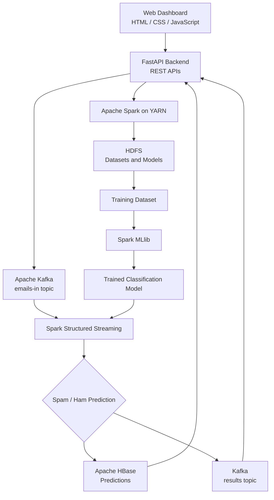
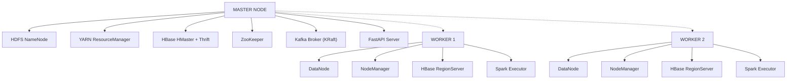
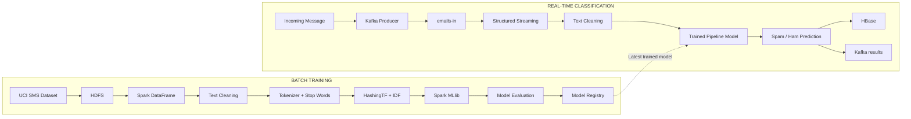

 <div align="center">

# Distributed Email Spam Classification
### A Distributed Big Data & Real-Time Machine Learning System

**Built with Apache Hadoop · Apache Spark MLlib · Apache Kafka · Apache HBase · FastAPI**


**Big Data Laboratory Project · Academic Session 2026–2027**

| **Institution** | National Institute of Technology Delhi |
|---|---|
| **Department** | Computer Science and Engineering |
| **Class / Section** | CSE-2 |
| **Subject** | Big Data |
| **Faculty** | Dr. Himadri Singh |

</div>

---

## Project Team

**Team Name:** DataStream Innovators

| S. No. | Team Member | Roll Number |
|:---:|---|:---:|
| 1 | **Sumit Kumar** | `231210105` |
| 2 | **Tushar Verma** | `231210117` |
| 3 | **Tanishq Pruthi** | `231210113` |
| 4 | **Tashik Midhha** | `231210115` |

**Submitted to:** Dr. Himadri Singh  
**Department:** Computer Science and Engineering  
**Institution:** National Institute of Technology Delhi

---

# Read This Project Like a Report

This README is organised as a complete project report. Use the contents below to navigate through the chapters or read from beginning to end to understand the complete project journey—from the problem statement and theoretical foundations to architecture, implementation, deployment, evaluation, and future scope.

<details open>
<summary><strong>Table of Contents — Project Chapters</strong></summary>

1. [Abstract](#1-abstract)
2. [Introduction](#2-introduction)
3. [Problem Statement](#3-problem-statement)
4. [Objectives and Scope](#4-objectives-and-scope)
5. [Requirements and Dataset](#5-requirements-and-dataset)
6. [Theoretical Background](#6-theoretical-background)
7. [System Architecture](#7-system-architecture)
8. [Methodology and Working](#8-methodology-and-working)
9. [Machine Learning Algorithms](#9-machine-learning-algorithms)
10. [Implementation Details](#10-implementation-details)
11. [Project Directory Structure](#11-project-directory-structure)
12. [Installation and Cluster Setup](#12-installation-and-cluster-setup)
13. [Execution Guide](#13-execution-guide)
14. [Application Features and Monitoring](#14-application-features-and-monitoring)
15. [API Reference](#15-api-reference)
16. [Results and Performance Analysis](#16-results-and-performance-analysis)
17. [Testing and Verification](#17-testing-and-verification)
18. [Limitations and Challenges](#18-limitations-and-challenges)
19. [Applications and Future Scope](#19-applications-and-future-scope)
20. [Conclusion](#20-conclusion)
21. [References](#21-references)

</details>

---

# 1. Abstract

The rapid growth of digital communication has increased the volume of emails and text messages generated every day. Among these messages, spam can cause unnecessary storage consumption, reduce productivity, and expose users to phishing attempts, fraudulent offers, and misleading information. Automated spam detection is therefore an important application of machine learning and data analytics.

This project presents a **Distributed Email Spam Classification System using Apache Spark MLlib**, integrated with the Hadoop ecosystem. It classifies textual messages into two categories: **Spam** and **Ham**. Hadoop Distributed File System (HDFS) provides distributed storage, Apache Spark MLlib performs feature extraction and model training, Apache Kafka handles incoming messages, Spark Structured Streaming performs continuous classification, and Apache HBase stores predictions and execution information.

A FastAPI backend connects the processing components to a web-based monitoring dashboard. The application supports model training, individual message prediction, real-time message ingestion, live prediction monitoring, metric inspection, and structured error reporting.

The system is designed around a three-node topology consisting of one master and two worker nodes. Experiments using the UCI SMS Spam Collection dataset and an 80:20 train-test split produced **97.6% accuracy** with Logistic Regression and **96.4% accuracy** with Naive Bayes. Logistic Regression achieved a spam precision of 98.2%, recall of 82.6%, F1-score of 0.897, and false-positive rate of 0.22%.

The project demonstrates how distributed storage, machine learning, message ingestion, stream processing, and NoSQL persistence can be integrated into a single application.

**Keywords:** Big Data, Hadoop, HDFS, Apache Spark, Spark MLlib, Apache Kafka, Structured Streaming, HBase, Logistic Regression, Naive Bayes, Spam Classification.

---

# 2. Introduction

## 2.1 Introduction to Big Data

Big Data refers to extremely large and complex datasets that cannot be efficiently processed using traditional data-processing systems alone. With the growth of internet services, social media, banking systems, and digital communication, the amount of generated data has increased significantly.

The commonly discussed characteristics of Big Data are the **5 Vs**:

| Characteristic | Meaning |
|---|---|
| **Volume** | The enormous amount of data generated and stored. |
| **Velocity** | The speed at which data is generated and processed. |
| **Variety** | Different forms of data, including structured, semi-structured, and unstructured data. |
| **Veracity** | The quality, reliability, and accuracy of data. |
| **Value** | Useful information that can be extracted from data. |

Distributed frameworks such as Hadoop and Spark help store, process, and analyse large datasets across multiple machines.

## 2.2 Email Spam Classification

Spam classification is a machine-learning task that automatically identifies unwanted or suspicious messages by analysing their textual content.

The system uses two classes:

- **Spam:** Unwanted or suspicious messages, such as promotional or fraudulent messages.
- **Ham:** Legitimate messages.

Traditional single-machine approaches can face resource and scalability limitations as data volume increases. Distributed processing allows data and computation to be handled across multiple machines.

## 2.3 Motivation

The project was undertaken to understand how Big Data technologies work together in a practical classification application. The main motivations were:

- Understanding distributed data storage using HDFS.
- Learning parallel data processing with Apache Spark.
- Implementing machine learning using Spark MLlib.
- Exploring real-time message ingestion using Kafka.
- Processing continuous data streams using Spark Structured Streaming.
- Storing predictions using HBase.
- Building a monitoring interface for a distributed application.

## 2.4 Proposed Solution

The proposed system contains two connected processing pipelines:

1. **Batch training pipeline:** Loads a labelled dataset, cleans the text, extracts numerical features, trains classification models, evaluates them, and stores the trained model.
2. **Real-time classification pipeline:** Receives messages through Kafka, processes them using Spark Structured Streaming, predicts Spam or Ham using the trained model, and stores the results in HBase and Kafka.

A FastAPI backend connects these services with the web dashboard.

---

# 3. Problem Statement

The increasing volume of electronic communication creates a need for automated systems that can identify spam messages accurately and efficiently. Processing a large number of messages with a traditional single-machine application may become computationally expensive and difficult to scale.

The project addresses the problem of designing a distributed machine-learning application that can:

1. Process textual datasets.
2. Train classification models.
3. Identify spam and legitimate messages.
4. Support continuous ingestion of incoming messages.
5. Store classification results efficiently.
6. Provide monitoring and execution information.
7. Support distributed execution across multiple machines.

## 3.1 Existing System and Its Challenges

Traditional spam detection systems often execute models on individual machines. Although they can achieve good classification results, they may face:

- Limited processing resources.
- Difficulty handling continuous data streams.
- Storage limitations.
- Limited scalability.
- Limited visibility into distributed execution.

## 3.2 Proposed System

The proposed system integrates multiple Big Data technologies:

| Requirement | Proposed Component |
|---|---|
| Distributed data storage | Hadoop HDFS |
| Parallel processing | Apache Spark |
| Model training and prediction | Spark MLlib |
| Real-time message ingestion | Apache Kafka |
| Stream processing | Spark Structured Streaming |
| Prediction storage | Apache HBase |
| Backend integration | FastAPI |
| Monitoring | Web dashboard |

---

# 4. Objectives and Scope

## 4.1 Objectives

The primary objective is to develop a distributed Spam/Ham classification system using Big Data technologies.

Specific objectives:

1. Understand the Hadoop ecosystem and distributed computing.
2. Configure HDFS for storing datasets.
3. Perform distributed data processing using Apache Spark.
4. Implement machine-learning algorithms using Spark MLlib.
5. Perform text preprocessing and feature extraction.
6. Train and evaluate Logistic Regression and Naive Bayes models.
7. Integrate Kafka for real-time message ingestion.
8. Implement stream processing using Spark Structured Streaming.
9. Store predictions in Apache HBase.
10. Develop a FastAPI-based backend.
11. Develop a web-based monitoring dashboard.
12. Implement structured error handling and pipeline phase tracking.

## 4.2 Scope

The project covers:

- **Data processing:** Reading and preparing textual datasets.
- **Distributed storage:** Using HDFS for input datasets and model files.
- **Machine learning:** Training and evaluating classifiers using Spark MLlib.
- **Real-time processing:** Using Kafka and Spark Structured Streaming.
- **Distributed database:** Using HBase for predictions and pipeline execution information.
- **Monitoring:** Observing application status, model metrics, and execution phases through a web interface.

The architecture is designed around one master node and two worker nodes. Performance benchmarking across different cluster sizes is considered future work.

---

# 5. Requirements and Dataset

## 5.1 Software Requirements

| Software / Technology | Version / Configuration | Purpose |
|---|---|---|
| Python | 3.10+ | Application development |
| Java | 11 | Runtime environment |
| Apache Hadoop | 3.3.6 | Distributed computing ecosystem |
| HDFS | Hadoop component | Distributed storage |
| YARN | Hadoop component | Resource management |
| Apache Spark / PySpark | 3.5.3 | Distributed processing |
| Spark MLlib | Spark component | Machine learning |
| Apache Kafka | 3.6.1, KRaft mode | Real-time message ingestion |
| Spark Structured Streaming | Spark component | Stream processing |
| Apache HBase | 2.5.8 | Distributed NoSQL database |
| ZooKeeper | HBase-managed | HBase coordination |
| FastAPI + Uvicorn | — | Backend and API server |
| HTML, CSS, JavaScript | — | Frontend dashboard |

## 5.2 Hardware and Network Requirements

| Component | Requirement |
|---|---|
| Processor | Multi-core processor |
| RAM | 8 GB or higher recommended per machine |
| Storage | 20 GB or more free space |
| Network | LAN / host-only connectivity between nodes |
| Operating System | Ubuntu Linux 22.04 |
| HDFS replication | 2 |

The deployment topology uses three machines connected through a private network. Configure the actual IP addresses for the environment in use rather than copying example addresses without verification.

## 5.3 Dataset

The project uses the **UCI SMS Spam Collection** dataset.

- Total labelled messages: **5,574**
- Each record contains a class label (`spam` or `ham`) and message text.
- Approximately **13%** of the messages belong to the spam class.
- The dataset is imbalanced and contains short SMS messages rather than long-form email content.

The dataset is used to train and evaluate the classification models. This distinction is important when interpreting how well the results may generalise to larger email datasets.

---

# 6. Theoretical Background

## 6.1 Apache Hadoop

Apache Hadoop is an open-source framework for distributed storage and processing of large datasets. Its major components include Hadoop Common, HDFS, YARN, and MapReduce.

### Hadoop Distributed File System (HDFS)

HDFS divides large files into blocks and distributes those blocks across DataNodes.

- **NameNode:** Maintains filesystem metadata, directory structure, and block locations.
- **DataNode:** Stores the actual data blocks and handles read/write operations.

### Yet Another Resource Negotiator (YARN)

YARN manages cluster resources and schedules applications.

Its major components include:

- ResourceManager
- NodeManagers
- ApplicationMaster for each application

In this project, YARN manages resources for Spark jobs.

## 6.2 Apache Spark

Apache Spark is a distributed data-processing framework designed for fast and scalable computation. It supports batch processing, stream processing, machine learning, SQL processing, and graph analytics.

A Spark driver coordinates execution, while executors perform distributed tasks. Spark can cache intermediate data in memory, which can improve performance for suitable workloads.

## 6.3 Spark MLlib

Spark MLlib is Apache Spark's machine-learning library. It provides algorithms and pipeline abstractions for chaining feature transformers and estimators.

In this project, MLlib is used for:

- Text feature extraction.
- Model training.
- Spam/Ham classification.
- Model evaluation.

The implemented algorithms are Logistic Regression and Naive Bayes.

## 6.4 Apache Kafka

Apache Kafka is a distributed event-streaming platform used to collect, store, and distribute messages.

Important concepts:

- **Producer:** Publishes messages to Kafka topics.
- **Consumer:** Reads messages from Kafka topics.
- **Topic:** A logical category in which messages are stored.
- **Partition:** Divides a topic into ordered message streams.
- **Broker:** A Kafka server that stores and serves messages.

The project uses two topics:

| Topic | Purpose |
|---|---|
| `emails-in` | Receives incoming messages |
| `results` | Carries classification results |

Kafka decouples message ingestion from downstream processing.

## 6.5 Spark Structured Streaming

Spark Structured Streaming is a stream-processing engine built on Spark SQL. It processes incoming data using a DataFrame-based programming model and micro-batches.

In this project, it consumes messages from Kafka, applies the cleaning and feature pipeline, classifies messages, and sends predictions to storage.

## 6.6 Apache HBase

Apache HBase is a distributed, column-family-oriented NoSQL database built on HDFS. It stores prediction records and execution information.

The project defines four HBase tables:

| Table | Purpose |
|---|---|
| `predictions` | Classification predictions; row key uses reverse timestamp and email ID |
| `model_runs` | Model execution information |
| `phase_log` | Pipeline phase information |
| `datasets` | Dataset-related information |

The backend accesses HBase through the Thrift gateway.

## 6.7 FastAPI

FastAPI is a Python web framework used to build REST APIs. It provides request validation and automatic API documentation.

In this project, it acts as the communication layer between the dashboard and backend services under the `/api/v1` prefix.

## 6.8 ZooKeeper and Kafka KRaft

ZooKeeper is used for coordination by HBase in this configuration. Kafka is configured separately in **KRaft mode**, so the Kafka broker does not depend on ZooKeeper.

---

# 7. System Architecture

The application follows a distributed architecture that combines batch machine learning and real-time stream processing.

## 7.1 High-Level Architecture



**Architecture explanation:** The dashboard communicates with FastAPI, which exposes training, prediction, and monitoring operations. Spark performs machine learning using data stored in HDFS. Kafka receives incoming messages, Spark Structured Streaming classifies them, and the results are written to HBase and the Kafka results topic.

## 7.2 Three-Node Distributed Cluster

The system is designed around one master and two worker nodes.



| Node | Services |
|---|---|
| **Master** | NameNode, ResourceManager, HMaster, ZooKeeper, Kafka broker, HBase Thrift, FastAPI |
| **Worker 1** | DataNode, NodeManager, HBase RegionServer, Spark executor |
| **Worker 2** | DataNode, NodeManager, HBase RegionServer, Spark executor |

The master coordinates the cluster. Worker nodes provide distributed storage and processing resources.

## 7.3 Batch Training and Real-Time Classification



The batch and streaming paths share the same text-cleaning logic and trained pipeline model to keep preprocessing consistent.

---

# 8. Methodology and Working

The application follows seven sequential execution phases, labelled P1 to P7. The dashboard displays the progress of these phases.

| Phase | Name | Responsibility |
|---|---|---|
| P1 | `INGEST` | Dataset ingestion |
| P2 | `CLEAN` | Text cleaning and preprocessing |
| P3 | `FEATURES` | Feature extraction |
| P4 | `TRAIN` | Model training |
| P5 | `EVALUATE` | Model evaluation |
| P6 | `SAVE_MODEL` | Model persistence |
| P7 | `STREAM` | Real-time classification |

## 8.1 P1 — Data Ingestion

The first phase reads the input CSV containing label and text columns and prepares the records for processing. The dataset is stored in HDFS, with the default path configured as `/data/raw/sms.csv`.

## 8.2 P2 — Data Cleaning and Preprocessing

The same cleaning function is shared by training and streaming so both pipelines process text consistently.

The cleaning operations include:

- Dropping rows with a missing label or message text.
- Removing duplicate messages.
- Converting text to lowercase.
- Removing HTML tags.
- Replacing URLs with a placeholder token.
- Removing digits and punctuation.
- Collapsing extra whitespace.
- Removing messages that become empty.
- Mapping labels to `1.0` for spam and `0.0` for ham.

## 8.3 P3 — Feature Extraction

Machine-learning algorithms require numerical input. The project uses a Spark ML pipeline:

1. **Tokenizer:** Splits each message into words.
2. **StopWordsRemover:** Removes frequent words that carry limited classification information.
3. **HashingTF:** Maps terms to a fixed-size term-frequency vector of 262,144 (`2^18`) features.
4. **IDF:** Rescales term frequencies according to how rare each term is across the collection.

The TF-IDF weight is:

\[
\operatorname{TF\text{-}IDF}(t,d)=\operatorname{TF}(t,d)\times\operatorname{IDF}(t)
\]

Here, \(t\) is a term and \(d\) is a document. Terms that occur frequently in one message but are relatively rare across the collection receive higher weights.

## 8.4 P4 — Model Training

The prepared dataset is divided into training and test subsets using an **80:20 random split with a fixed seed**.

- Logistic Regression is the primary model.
- Naive Bayes is available as an alternative.
- Class weights are applied to Logistic Regression to account for the approximately 13% spam class.
- An optional three-fold cross-validation can be enabled from the Train tab.

Configured model parameters:

| Model | Configuration |
|---|---|
| Logistic Regression | 50 iterations; regularisation 0.01 |
| Naive Bayes | Smoothing 1.0 |

## 8.5 P5 — Model Evaluation

The model is evaluated on the test subset using:

- Accuracy
- Precision
- Recall
- F1-score
- AUC
- False-positive rate
- Confusion matrix

A minimum accuracy threshold of 95% is configured. A run below the threshold raises a coded error.

## 8.6 P6 — Model Storage

The trained pipeline model and its metadata are saved through the model registry. The registry assigns incrementing model versions. The latest version is loaded by the prediction API and streaming job.

## 8.7 P7 — Real-Time Streaming

1. Incoming messages are published to Kafka topic `emails-in`.
2. Spark Structured Streaming consumes messages in micro-batches.
3. Messages are cleaned and classified using the latest trained model.
4. Predictions are written to HBase and Kafka topic `results`.
5. The phase tracker records status, duration, and error code.

---

# 9. Machine Learning Algorithms

## 9.1 Logistic Regression

Logistic Regression is a supervised learning algorithm used for binary classification. It estimates the probability that a message belongs to the spam class.

\[
P(y=1\mid x)=\frac{1}{1+e^{-z}}
\qquad
z=w^Tx+b
\]

Where:

- \(x\) is the input feature vector.
- \(w\) is the learned weight vector.
- \(b\) is the bias.
- \(P(y=1\mid x)\) is the estimated probability of spam.

A probability threshold is used to assign the predicted class.

**Why it is used:** It works with sparse text features, produces probability-based outputs, and achieved stronger results than Naive Bayes in the reported experiment.

## 9.2 Naive Bayes

Naive Bayes is a probabilistic classifier based on Bayes' theorem:

\[
P(C\mid X)=\frac{P(X\mid C)\cdot P(C)}{P(X)}
\]

It assumes conditional independence of features given the class. It is computationally efficient and suitable for high-dimensional text features.

## 9.3 Algorithm Comparison

| Parameter | Logistic Regression | Naive Bayes |
|---|---|---|
| Learning type | Supervised | Supervised |
| Approach | Discriminative | Probabilistic generative |
| Output | Class probability | Class probability |
| Training cost | Relatively efficient | Very efficient |
| Class imbalance | Class weights applied | No class weighting applied |
| Observed result | Higher accuracy and F1-score | Faster training |

---

# 10. Implementation Details

The codebase is divided into modules to keep the application organised and testable.

## 10.1 Data Ingestion Module

`src/ingestion/loader.py` reads the input CSV and validates its schema. `kafka_producer.py` publishes messages to Kafka for streaming tests.

## 10.2 Preprocessing Module

`src/preprocessing/cleaner.py` implements the text-cleaning operations. The same function is used by the training and streaming pipelines.

## 10.3 Machine Learning Module

The `src/ml/` package contains:

- `features.py` — feature construction.
- `trainer.py` and `train_job.py` — model training.
- `evaluator.py` — model evaluation.
- `model_registry.py` — model versioning and persistence.

The training entry point is `src/ml/trainer.py`, which delegates to `train_job.py`.

## 10.4 Streaming Module

`src/streaming/stream_predictor.py` reads from Kafka topic `emails-in` using Spark Structured Streaming, scores each micro-batch with the latest model, and writes results to HBase and Kafka.

## 10.5 Storage Module

`src/storage/` provides the HDFS and HBase clients.

## 10.6 API Module

`src/api/` contains the FastAPI application and routes for training, prediction, and status monitoring.

## 10.7 Frontend Module

The frontend in `ui/` uses HTML, CSS, and JavaScript. It provides six main tabs:

| Dashboard Tab | Functionality |
|---|---|
| Dashboard | Counts and spam-probability histogram |
| Train | Dataset path, algorithm selection, and cross-validation |
| Predict | Classify a pasted message or send it to Kafka |
| Live Stream | View recent prediction rows from HBase |
| Metrics | Accuracy, precision, recall, F1, AUC, and confusion matrix |
| Logs | View phase logs and filter by error code |

The header also displays status indicators for the master, worker1, worker2, and the active model.

## 10.8 Error Handling and Phase Tracking

The application uses structured error codes in the form `SPM-<MODULE>-<NNN>`. Each error includes a message, probable cause, and hint.

Every pipeline phase records:

- Start, success, or failure status.
- Execution duration.
- Associated error code.

Events are written to the console, `logs/spam.log`, and the HBase `phase_log` table.

---

# 11. Project Directory Structure

```text
spam-classifier/
│
├── cluster/
│   ├── env.sh
│   ├── setup_hadoop.sh
│   ├── setup_spark.sh
│   ├── setup_kafka.sh
│   ├── setup_hbase.sh
│   ├── start_all.sh
│   ├── stop_all.sh
│   └── health_check.sh
│
├── config/
│   ├── cluster.yaml
│   └── settings.yaml
│
├── data/
│   ├── raw/
│   └── sample/
│       └── sms.csv
│
├── src/
│   ├── common/
│   ├── ingestion/
│   ├── preprocessing/
│   ├── ml/
│   ├── streaming/
│   ├── storage/
│   └── api/
│
├── ui/
│   ├── index.html
│   ├── css/
│   │   └── style.css
│   └── js/
│       ├── app.js
│       ├── api.js
│       └── charts.js
│
├── tests/
│   ├── unit/
│   ├── integration/
│   └── e2e/
│
├── docs/
│   ├── architecture.md
│   ├── setup.md
│   ├── api.md
│   ├── errors.md
│   ├── testing.md
│   └── demo_commands.md
│
├── requirements.txt
└── README.md
```

---

# 12. Installation and Cluster Setup

## 12.1 Prerequisites

For the distributed setup, prepare three Ubuntu 22.04 machines connected to the same network.

Install or configure:

- Python 3.10+
- Java 11
- Hadoop 3.3.6
- Spark 3.5.3
- Kafka 3.6.1
- HBase 2.5.8

Ensure that the same Linux username and project directory path are used on all nodes.

## 12.2 Configure the Nodes

Configure static or otherwise stable network addresses and update `config/cluster.yaml` and `/etc/hosts` on all machines.

Example only — replace these addresses with the actual addresses of your machines:

```text
192.168.1.10 master
192.168.1.11 worker1
192.168.1.12 worker2
```

Clone the repository on all three nodes using the same directory path:

```bash
git clone <YOUR_REPOSITORY_URL> ~/spam-classifier
cd ~/spam-classifier
```

Configure passwordless SSH from the master:

```bash
ssh-keygen -t ed25519
ssh-copy-id master
ssh-copy-id worker1
ssh-copy-id worker2
```

Ensure that the required ports are reachable between the machines. Apply firewall changes appropriate to your lab network and security requirements.

## 12.3 Install Hadoop

Run the Hadoop setup script on each machine, using the appropriate node role:

```bash
# On the master
./cluster/setup_hadoop.sh master

# On worker1 and worker2
./cluster/setup_hadoop.sh worker
```

## 12.4 Install HBase

Run on all three machines:

```bash
./cluster/setup_hbase.sh
```

## 12.5 Install Spark and Kafka

Run on the master:

```bash
./cluster/setup_spark.sh
./cluster/setup_kafka.sh
```

Reload the shell environment if required:

```bash
source ~/.bashrc
```

## 12.6 Start and Verify the Cluster

On the master:

```bash
./cluster/start_all.sh
./cluster/health_check.sh
```

The startup script is configured to start the services and prepare the required HDFS paths, Kafka topics, and HBase tables.

Useful web interfaces:

| Service | Address |
|---|---|
| HDFS NameNode UI | `http://master:9870` |
| YARN ResourceManager UI | `http://master:8088` |
| HBase Master UI | `http://master:16010` |

## 12.7 Upload the Dataset

```bash
hdfs dfs -put data/sample/sms.csv /data/raw/
```

Refer to [`docs/setup.md`](docs/setup.md) for the detailed setup sequence and troubleshooting guidance.

---

# 13. Execution Guide

Run the following commands from the project directory on the master node after the required services have been configured.

## 13.1 Train Logistic Regression

```bash
spark-submit --master yarn src/ml/trainer.py --algo logreg
```

## 13.2 Train Naive Bayes

```bash
spark-submit --master yarn src/ml/trainer.py --algo nb
```

## 13.3 Start the Streaming Pipeline

```bash
spark-submit --master yarn \
  --packages org.apache.spark:spark-sql-kafka-0-10_2.12:3.5.3 \
  src/streaming/stream_predictor.py
```

## 13.4 Publish Sample Messages to Kafka

```bash
python -m src.ingestion.kafka_producer --rate 5 --limit 100
```

## 13.5 Start the Backend and Dashboard

```bash
uvicorn src.api.main:app --host 0.0.0.0 --port 8000
```

Open the application at:

```text
http://master:8000
```

FastAPI interactive API documentation:

```text
http://master:8000/docs
```

## 13.6 Local Development Without a Distributed Cluster

For single-machine development, the application can be started in local Spark mode:

```bash
SPAM_SPARK_MASTER='local[*]' \
SPAM_ALLOW_MEMORY_STORE=1 \
uvicorn src.api.main:app --host 0.0.0.0 --port 8000
```

This mode is useful for local development and testing. It should not be confused with a multi-node distributed deployment.

---

# 14. Application Features and Monitoring

The web dashboard provides a unified view of the classification system.

| Feature | Description |
|---|---|
| Training control | Start model training and inspect the current run |
| Prediction | Submit an individual message for classification |
| Kafka ingestion | Send messages to the incoming Kafka topic |
| Live stream | Inspect recent prediction records stored in HBase |
| Metrics | View model evaluation metrics and confusion matrix |
| Phase tracking | Inspect progress through P1–P7 |
| Logs | Review execution events and coded errors |
| Cluster indicators | View status indicators for master and worker nodes |

## 14.1 Pipeline Execution Phases

| Phase | Description |
|---|---|
| P1 — INGEST | Dataset ingestion |
| P2 — CLEAN | Text preprocessing |
| P3 — FEATURES | Feature extraction |
| P4 — TRAIN | Model training |
| P5 — EVALUATE | Model evaluation |
| P6 — SAVE_MODEL | Model persistence |
| P7 — STREAM | Real-time classification |

## 14.2 Example Error Codes

| Error Code | Description |
|---|---|
| `SPM-API-901` | Request validation failure |
| `SPM-CLU-101` | HDFS NameNode unavailable |
| `SPM-CLU-102` | DataNode unavailable |
| `SPM-CLU-103` | YARN unavailable |
| `SPM-CLU-104` | Kafka broker unavailable |
| `SPM-CLU-105` | HBase master unavailable |
| `SPM-ING-201` | Input file not found |
| `SPM-FEA-401` | Tokenizer failure |
| `SPM-TRN-501` | Executor out of memory |
| `SPM-STR-801` | Kafka offset error |

The complete error catalogue is maintained in [`docs/errors.md`](docs/errors.md).

---

# 15. API Reference

**Base path:** `/api/v1`

| Method | Endpoint | Description |
|---|---|---|
| `POST` | `/train` | Start model training |
| `GET` | `/train/result` | Retrieve training status and results |
| `POST` | `/predict` | Classify an individual message |
| `POST` | `/send` | Send an email/message to Kafka |
| `GET` | `/status` | Retrieve pipeline and cluster status |
| `GET` | `/metrics` | Retrieve model evaluation metrics |
| `GET` | `/predictions` | Retrieve recent predictions |
| `GET` | `/logs` | Retrieve execution logs |
| `GET` | `/errors` | Retrieve the error-code catalogue |

For interactive request and response schemas, start the backend and visit `/docs`. Additional details are maintained in [`docs/api.md`](docs/api.md).

---

# 16. Results and Performance Analysis

The reported experiment uses the UCI SMS Spam Collection dataset with an 80:20 train-test split.

**Number of test messages: 1,027**

## 16.1 Logistic Regression Results

| Metric | Target | Achieved Result |
|---|---:|---:|
| Accuracy | ≥ 95% | **97.6%** |
| Precision (Spam) | — | **98.2%** |
| Recall (Spam) | — | **82.6%** |
| Spam F1-score | ≥ 0.94 | **0.897** |
| False-positive rate | < 2% | **0.22%** |

## 16.2 Model Comparison

| Model | Accuracy | Spam F1-score |
|---|---:|---:|
| **Logistic Regression** | **97.6%** | **0.897** |
| Naive Bayes | 96.4% | 0.853 |

Logistic Regression achieved better accuracy and spam F1-score on the evaluated dataset and was selected as the primary model.

## 16.3 Confusion Matrix

The Logistic Regression confusion matrix contains:

| Actual / Predicted | Predicted Ham | Predicted Spam |
|---|---:|---:|
| **Actual Ham** | 893 | 2 |
| **Actual Spam** | 23 | 109 |

The reported metrics follow from these values:

- Accuracy = (893 + 109) / 1,027 = **97.6%**
- Precision = 109 / (109 + 2) = **98.2%**
- Recall = 109 / (109 + 23) = **82.6%**

The low false-positive count indicates that very few legitimate messages were incorrectly classified as spam. Recall is comparatively weaker, meaning some spam messages were classified as ham.

## 16.4 Dashboard and Streaming Observations

The project report records the following application observations:

- The dashboard displayed **128 classified messages** after prediction and streaming tests.
- The streaming job scored **127 messages across five micro-batches**.
- Predictions were visible through the Live Stream interface using HBase records.
- A sample legitimate meeting message was classified as Not Spam with a reported spam probability of 2.5%.

The 127-message streaming observation and the dashboard count of 128 are reported as observed values; they are not a latency or throughput benchmark.

## 16.5 Test Results

- **27 tests passed locally**, as reported by the project test run.
- Overall reported test coverage: **78%**.
- Core ML, API, and common modules reached coverage in the 76–100% range.
- The project target for unit-test coverage was 80%, so the reported 78% is slightly below target.

## 16.6 Interpretation

The TF-IDF and Logistic Regression pipeline separates spam from ham effectively on this dataset, with high precision and a very low false-positive rate. Recall is the weaker metric. The spam F1-score of 0.897 did not meet the original target of 0.94.

The results should be interpreted in the context of a relatively small, imbalanced SMS dataset. SMS messages are generally shorter than emails, so performance on larger email datasets may differ.

---

# 17. Testing and Verification

The project uses unit tests, API integration tests, and a distributed end-to-end smoke test.

## 17.1 Run the Test Suite

```bash
python -m pytest -q
```

## 17.2 Run Tests with Coverage

```bash
python -m pytest -q --cov=src
```

## 17.3 Run the End-to-End Smoke Test

```bash
python tests/e2e/smoke.py http://master:8000
```

The end-to-end test requires the distributed services and backend to be running.

## 17.4 Verification Summary

The project report distinguishes automated local testing from observations made on the deployed environment.

| Component | Reported Verification |
|---|---|
| Batch ML training | Automated tests; training runs completed in the deployed environment |
| FastAPI backend | Automated tests; requests served on the deployed master |
| Web interface | Running and reachable |
| Error handling and phase tracking | Automated tests; phase events visible in dashboard logs |
| Kafka → Spark → HBase streaming | Observed working; micro-batches scored and predictions listed from HBase |
| HBase persistence | Observed through Thrift connection and prediction rows |
| HDFS and YARN | Configured and used by the pipeline; dedicated HDFS/YARN evidence was not included in the report |
| Multi-worker speed-up | Not measured |
| Streaming latency | Not measured |

The report also records a local test coverage of 78%. Distributed integration and performance measurements should therefore be interpreted separately from the local automated test results.

---

# 18. Limitations and Challenges

## 18.1 Dataset Limitations

The experiments use the UCI SMS Spam Collection. SMS messages are shorter than typical emails and may have different language patterns. The reported results may not directly generalise to longer email content.

## 18.2 Model Performance

The spam F1-score of 0.897 is below the target of 0.94. The comparatively lower recall of 82.6% indicates that some spam messages are missed.

Potential areas for improvement include better feature engineering, threshold tuning, and evaluation on larger datasets.

## 18.3 Performance Benchmarking

Streaming latency and speed-up from additional workers have not been measured. A controlled benchmark would require repeated runs with different worker counts and workloads.

Training time varied considerably across recorded runs (approximately 131–628 seconds). These observations come from a shared virtual environment and should not be treated as a formal performance benchmark.

## 18.4 Test Coverage

Overall coverage is 78%, slightly below the 80% target. Some Kafka, HDFS, and streaming paths require distributed services and are not covered by the local unit-test run.

## 18.5 Deployment Challenges Recorded

The project report records the following issues encountered during deployment:

- **Preprocessing serialization issue (`SPM-PRE-301`):** An early CLEAN phase failed with a Python serialization/recursion error. Later runs completed successfully.
- **HBase write issue (`SPM-STR-803`):** Initial HBase writes failed while the Thrift connection was not yet working. The issue stopped appearing after the connection was established.
- **Run-to-run timing variation:** Training duration varied across runs on shared virtual machines.

The structured error codes and phase logs helped identify the stage and likely cause of these problems.

---

# 19. Applications and Future Scope

## 19.1 Applications

The system's approach can be applied to:

1. Email spam filtering.
2. SMS spam detection.
3. Phishing-message identification.
4. Fraudulent communication detection.
5. Large-scale text classification.
6. Real-time content moderation.
7. Distributed message analytics.

## 19.2 Future Improvements

- Train and evaluate on larger datasets such as SpamAssassin and Enron email corpora.
- Explore advanced classifiers and NLP techniques.
- Tune the classification threshold to improve spam recall.
- Add ROC and Precision-Recall visualisations.
- Measure real-time streaming latency.
- Benchmark execution with different worker counts.
- Test recovery when a worker or service fails during execution.
- Expand unit and distributed integration test coverage.
- Add richer dashboard monitoring and alerting.

---

# 20. Conclusion

The project demonstrates a distributed email spam classification application built using the Hadoop ecosystem. It combines Apache Hadoop, Apache Spark MLlib, Apache Kafka, Apache HBase, and FastAPI into an integrated architecture for batch machine learning and real-time message processing.

The batch component performs text cleaning, TF-IDF feature extraction, model training, and evaluation using Logistic Regression and Naive Bayes. The real-time component uses Kafka for message ingestion and Spark Structured Streaming for continuous classification. Predictions are stored in HBase and made available through a web-based dashboard.

On the evaluated UCI SMS Spam Collection test split, Logistic Regression achieved 97.6% accuracy, 98.2% precision, 82.6% recall, a spam F1-score of 0.897, and a false-positive rate of 0.22%. It outperformed Naive Bayes on the reported accuracy and F1-score. The spam F1 target of 0.94 was not reached, and streaming latency and multi-worker performance remain to be measured.

Overall, the project provided practical experience with distributed storage, resource management, parallel processing, machine learning, stream processing, NoSQL databases, API development, and monitoring. It demonstrates how these technologies can be integrated into a distributed classification application.

---

# 21. References

1. [Apache Hadoop Documentation](https://hadoop.apache.org/docs/)
2. [Apache Spark Documentation](https://spark.apache.org/docs/latest/)
3. [Apache Spark MLlib Guide](https://spark.apache.org/docs/latest/ml-guide.html)
4. [Spark Structured Streaming Programming Guide](https://spark.apache.org/docs/latest/structured-streaming-programming-guide.html)
5. [Apache Kafka Documentation](https://kafka.apache.org/documentation/)
6. [Apache HBase Reference Guide](https://hbase.apache.org/book.html)
7. [FastAPI Documentation](https://fastapi.tiangolo.com/)
8. [PySpark API Documentation](https://spark.apache.org/docs/latest/api/python/)
9. T. A. Almeida, J. M. G. Hidalgo, and A. Yamakami, “Contributions to the Study of SMS Spam Filtering,” ACM DocEng, 2011; UCI Machine Learning Repository — SMS Spam Collection.
10. White, T., *Hadoop: The Definitive Guide*, O’Reilly Media.

---

## Project Documentation

The following supporting documents are maintained in the repository:

| Document | Description |
|---|---|
| [`docs/setup.md`](docs/setup.md) | Detailed installation and cluster configuration |
| [`docs/architecture.md`](docs/architecture.md) | Architecture and data flow |
| [`docs/api.md`](docs/api.md) | API reference |
| [`docs/errors.md`](docs/errors.md) | Error catalogue and troubleshooting |
| [`docs/testing.md`](docs/testing.md) | Test cases and coverage |
| [`docs/demo_commands.md`](docs/demo_commands.md) | Commands for project demonstration |

---

<div align="center">

**Distributed Email Spam Classification using Apache Spark MLlib**

*Big Data Laboratory · Department of Computer Science and Engineering*  
*National Institute of Technology Delhi · Academic Session 2026–2027*


---

# 📘 Complete Project Report

<div align="center">

### Go Beyond the README. Explore the Complete Report.

**Distributed Email Spam Classification using Apache Spark MLlib**

A detailed 34-page academic report covering the complete project journey, including system architecture, distributed cluster configuration, implementation, machine learning algorithms, deployment, experiments, and performance analysis.

<br/>

[](docs/Spam_Classifier_Big_Data_Report.pdf)

<br/>

| 📄 Report Information | Details |
|:---|:---|
| Document | Complete Project Report |
| Format | PDF |
| Pages | 34 |
| Subject | Big Data |
| Academic Session | 2026–2027 |
| Institution | National Institute of Technology Delhi |

<br/>

### Inside the Report

- Complete system architecture and workflow diagrams
- Three-node distributed cluster architecture
- Hadoop, Spark, Kafka and HBase implementation
- Machine learning algorithms and mathematical explanations
- Installation and execution procedures
- Application screenshots and deployment
- Model evaluation and performance analysis
- Testing, limitations and future enhancements

<br/>

**One Project. Multiple Technologies. A Complete Distributed Machine Learning System.**

<sub>Prepared by Team DataStream Innovators · NIT Delhi · CSE-2</sub>

</div>

---


</div>
