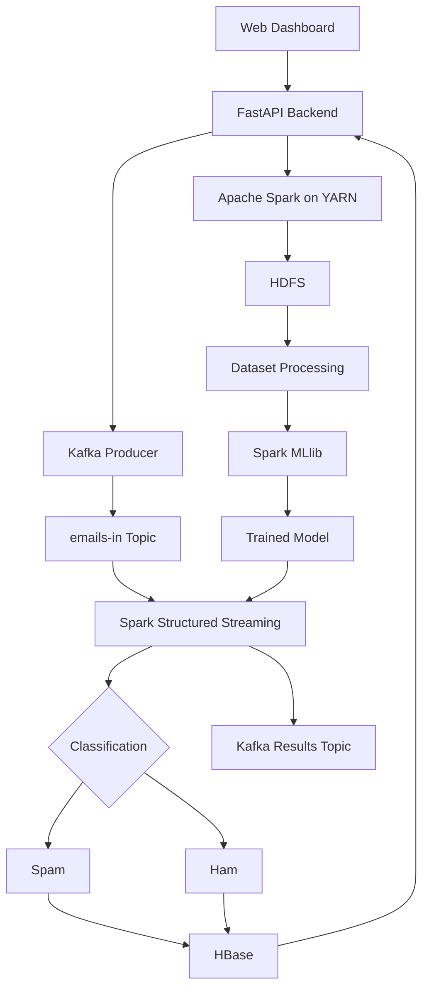
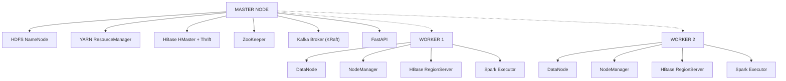
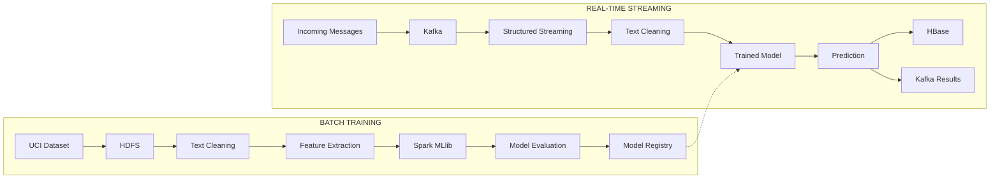

 <div align="center">

# DISTRIBUTED EMAIL SPAM CLASSIFICATION

### Distributed Big Data & Real-Time Machine Learning System

**Intelligent Spam Detection Using the Apache Hadoop Ecosystem**

<br/>


<br/>

**BIG DATA LABORATORY PROJECT | 2026–2027**

**National Institute of Technology Delhi**

Department of Computer Science and Engineering

</div>

---

## PROJECT INFORMATION

| Particulars | Details |
|:---|:---|
| Institution | National Institute of Technology Delhi |
| Department | Computer Science and Engineering |
| Class | CSE-2 |
| Subject | Big Data |
| Faculty | Dr. Himadri Singh |
| Academic Session | 2026–2027 |

## PROJECT TEAM

| S. No. | Name | Roll Number |
|:---:|---|:---:|
| 01 | **Sumit Kumar** | 231210105 |
| 02 | **Tushar Verma** | 231210117 |
| 03 | **Tanishq Pruthi** | 231210113 |
| 04 | **Tashik Midhha** | 231210115 |

---

# COMPLETE PROJECT REPORT

<div align="center">

### Explore the complete technical documentation

A detailed academic report covering the architecture, implementation, distributed processing, machine learning algorithms, experiments, and results.

<br/>

[](docs/Spam_Classifier_Big_Data_Report.pdf)

<br/>

| DOCUMENT | DETAILS |
|:---|:---|
| Format | PDF |
| Pages | 34 |
| Subject | Big Data |
| Institution | NIT Delhi |
| Academic Year | 2026–2027 |

**Inside the report**

- System architecture and distributed cluster design
- Hadoop, Spark, Kafka and HBase implementation
- Machine learning algorithms and mathematical foundations
- Installation and execution procedures
- Application screenshots and deployment
- Model evaluation and performance analysis
- Testing, limitations and future improvements

</div>

---

# TABLE OF CONTENTS

<details open>
<summary><strong>Explore all 21 chapters</strong></summary>

| Chapter | Section |
|:---:|---|
| 01 | [Abstract](#1-abstract) |
| 02 | [Introduction](#2-introduction) |
| 03 | [Problem Statement](#3-problem-statement) |
| 04 | [Objectives and Scope](#4-objectives-and-scope) |
| 05 | [Requirements and Dataset](#5-requirements-and-dataset) |
| 06 | [Theoretical Background](#6-theoretical-background) |
| 07 | [System Architecture](#7-system-architecture) |
| 08 | [Methodology and Working](#8-methodology-and-working) |
| 09 | [Machine Learning Algorithms](#9-machine-learning-algorithms) |
| 10 | [Implementation Details](#10-implementation-details) |
| 11 | [Project Structure](#11-project-directory-structure) |
| 12 | [Installation and Cluster Setup](#12-installation-and-cluster-setup) |
| 13 | [Execution Guide](#13-execution-guide) |
| 14 | [Application Features](#14-application-features-and-monitoring) |
| 15 | [API Reference](#15-api-reference) |
| 16 | [Results and Performance](#16-results-and-performance-analysis) |
| 17 | [Testing and Verification](#17-testing-and-verification) |
| 18 | [Limitations and Challenges](#18-limitations-and-challenges) |
| 19 | [Applications and Future Scope](#19-applications-and-future-scope) |
| 20 | [Conclusion](#20-conclusion) |
| 21 | [References](#21-references) |

</details>

---

# 01. ABSTRACT

The rapid growth of digital communication has significantly increased the volume of messages generated every day. Among these messages, spam can reduce productivity, consume storage, and expose users to phishing attempts and fraudulent information.

This project presents a **Distributed Email Spam Classification System** built using Apache Spark MLlib and the Hadoop ecosystem. The system classifies messages into two categories: **Spam** and **Ham**.

The architecture integrates several Big Data technologies:

- **Hadoop HDFS** for distributed data storage.
- **Apache Spark MLlib** for machine learning and model training.
- **Apache Kafka** for real-time message ingestion.
- **Spark Structured Streaming** for continuous classification.
- **Apache HBase** for storing predictions and execution information.
- **FastAPI** for backend services and API integration.

The application follows a three-node architecture consisting of one master and two worker nodes. It uses the UCI SMS Spam Collection dataset containing 5,574 labelled messages.

Two classification algorithms, Logistic Regression and Naive Bayes, are implemented and evaluated. Logistic Regression achieved **97.6% accuracy**, while Naive Bayes achieved **96.4% accuracy** on the reported test split.

The project demonstrates the integration of distributed storage, parallel processing, machine learning, real-time data ingestion, and NoSQL persistence into a unified application.

**Keywords:** Big Data, Distributed Computing, Hadoop, Spark, Kafka, HBase, Machine Learning, Spam Classification.

---

# 02. INTRODUCTION

## 2.1 Big Data

Big Data refers to large and complex datasets that cannot be efficiently processed using traditional data-processing systems alone.

Its major characteristics are represented by the 5 Vs:

| Characteristic | Description |
|---|---|
| Volume | Amount of data generated and stored |
| Velocity | Speed of data generation and processing |
| Variety | Different formats of data |
| Veracity | Reliability and quality of data |
| Value | Useful information extracted from data |

Distributed frameworks such as Hadoop and Spark enable large datasets to be stored and processed across multiple machines.

## 2.2 Spam Classification

Spam classification is a supervised machine-learning task that identifies unwanted messages based on their textual content.

The system uses two classes:

- **Spam:** Unwanted or suspicious messages.
- **Ham:** Legitimate messages.

The objective is to automate classification while maintaining high precision and reliable detection.

## 2.3 Motivation

The project explores how different Big Data technologies work together in a practical machine-learning application.

The primary motivations include:

- Distributed storage using HDFS.
- Parallel computation using Apache Spark.
- Text classification using Spark MLlib.
- Real-time message ingestion using Kafka.
- Continuous processing using Structured Streaming.
- Distributed persistence using HBase.
- Application monitoring through a web dashboard.

## 2.4 Proposed Solution

The system consists of two connected pipelines:

**Batch Training Pipeline**

Loads labelled data, performs text preprocessing, extracts numerical features, trains classification models, evaluates their performance, and saves the trained model.

**Real-Time Classification Pipeline**

Receives incoming messages through Kafka, processes them using Spark Structured Streaming, predicts Spam or Ham, and stores the results in HBase and Kafka.

FastAPI connects these services to the web dashboard.

---

# 03. PROBLEM STATEMENT

Traditional spam detection applications may encounter processing, storage, and scalability limitations when handling large volumes of messages.

The objective is to develop a distributed classification system capable of:

1. Processing textual datasets.
2. Training machine-learning models.
3. Identifying spam and legitimate messages.
4. Supporting continuous message ingestion.
5. Storing classification results efficiently.
6. Monitoring pipeline execution.
7. Supporting distributed execution across multiple machines.

## Existing System vs Proposed System

| Existing Approach | Proposed Approach |
|---|---|
| Single-machine processing | Distributed processing |
| Limited scalability | Hadoop and Spark ecosystem |
| Basic message ingestion | Kafka-based ingestion |
| Limited real-time processing | Structured Streaming |
| Conventional storage | HDFS and HBase |
| Limited monitoring | FastAPI dashboard |

---

# 04. OBJECTIVES AND SCOPE

## 4.1 Objectives

The main objectives are:

- Understand distributed computing and the Hadoop ecosystem.
- Configure HDFS for dataset storage.
- Perform distributed processing using Apache Spark.
- Implement Logistic Regression and Naive Bayes using MLlib.
- Perform text preprocessing and TF-IDF feature extraction.
- Integrate Kafka for real-time message ingestion.
- Implement Spark Structured Streaming.
- Store predictions using HBase.
- Develop REST APIs using FastAPI.
- Build a web-based monitoring dashboard.
- Implement structured error handling and phase tracking.

## 4.2 Project Scope

| Area | Implementation |
|---|---|
| Data Processing | Text preprocessing and cleaning |
| Distributed Storage | Hadoop HDFS |
| Machine Learning | Spark MLlib |
| Message Ingestion | Apache Kafka |
| Stream Processing | Structured Streaming |
| Database | Apache HBase |
| Backend | FastAPI |
| Frontend | HTML, CSS, JavaScript |
| Monitoring | Dashboard and execution logs |

The architecture is designed around one master node and two worker nodes. Multi-cluster performance benchmarking is considered future work.

---

# 05. REQUIREMENTS AND DATASET

## 5.1 Software Requirements

| Technology | Version | Purpose |
|---|---|---|
| Python | 3.10+ | Application development |
| Java | 11 | Runtime environment |
| Hadoop | 3.3.6 | Distributed ecosystem |
| HDFS | Hadoop component | Distributed storage |
| YARN | Hadoop component | Resource management |
| Apache Spark | 3.5.3 | Distributed processing |
| Spark MLlib | Spark component | Machine learning |
| Apache Kafka | 3.6.1 | Message ingestion |
| HBase | 2.5.8 | NoSQL database |
| ZooKeeper | HBase-managed | Coordination |
| FastAPI | — | Backend API |
| HTML/CSS/JavaScript | — | Frontend |

## 5.2 Hardware and Network Requirements

| Component | Requirement |
|---|---|
| Processor | Multi-core processor |
| RAM | 8 GB or higher recommended per machine |
| Storage | 20 GB or more free space |
| Operating System | Ubuntu Linux 22.04 |
| Network | LAN / host-only connectivity |
| HDFS Replication | 2 |

## 5.3 Dataset

**Dataset:** UCI SMS Spam Collection

<details>
<summary><strong>Dataset overview</strong></summary>

| Property | Details |
|---|---|
| Total Messages | 5,574 |
| Classes | Spam and Ham |
| Data Type | Text |
| Spam Distribution | Approximately 13% |
| Training Split | 80% |
| Testing Split | 20% |

Each record contains a message label and its corresponding text.

The dataset is imbalanced and contains short SMS messages rather than long-form email content. This distinction is important when interpreting the model's generalisation to larger email datasets.

</details>

---

# 06. THEORETICAL BACKGROUND

## 6.1 Apache Hadoop

Apache Hadoop is an open-source framework for distributed storage and processing.

Its major components include:

- **HDFS:** Distributed file storage.
- **YARN:** Cluster resource management.
- **MapReduce:** Distributed batch computation.
- **Hadoop Common:** Shared libraries and utilities.

### HDFS Architecture

| Component | Responsibility |
|---|---|
| NameNode | Maintains filesystem metadata and block locations |
| DataNode | Stores actual data blocks |

HDFS divides large files into blocks and distributes them across DataNodes.

### YARN

YARN manages cluster resources and schedules applications through:

- ResourceManager
- NodeManagers
- ApplicationMaster

In this project, YARN manages Spark application resources.

## 6.2 Apache Spark

Apache Spark is a distributed processing framework supporting:

- Batch processing
- Stream processing
- Machine learning
- SQL analytics
- Graph processing

The Spark driver coordinates execution, while executors perform distributed tasks.

## 6.3 Spark MLlib

Spark MLlib provides machine-learning algorithms and pipeline abstractions.

It is used for:

- Feature extraction.
- Model training.
- Classification.
- Model evaluation.

## 6.4 Apache Kafka

Kafka is a distributed event-streaming platform.

| Concept | Description |
|---|---|
| Producer | Publishes messages |
| Consumer | Reads messages |
| Topic | Logical message category |
| Partition | Divides a topic into ordered streams |
| Broker | Stores and serves messages |

The project uses two topics:

| Topic | Purpose |
|---|---|
| `emails-in` | Incoming messages |
| `results` | Classification results |

## 6.5 Spark Structured Streaming

Structured Streaming provides a DataFrame-based interface for processing continuous data streams.

The project consumes Kafka messages in micro-batches, applies the classification pipeline, and forwards predictions to storage.

## 6.6 Apache HBase

HBase is a distributed, column-family-oriented NoSQL database built on HDFS.

The project defines four tables:

| Table | Purpose |
|---|---|
| `predictions` | Classification records |
| `model_runs` | Model execution information |
| `phase_log` | Pipeline execution logs |
| `datasets` | Dataset-related information |

The backend communicates with HBase through the Thrift gateway.

## 6.7 FastAPI

FastAPI provides REST endpoints for:

- Training.
- Prediction.
- Status monitoring.
- Metrics.
- Logs.
- Error information.

The API uses the `/api/v1` prefix.

## 6.8 ZooKeeper and Kafka KRaft

ZooKeeper is used for HBase coordination in this configuration.

Kafka operates separately in KRaft mode and does not depend on ZooKeeper.

---

# 07. SYSTEM ARCHITECTURE

The application combines batch machine learning and real-time classification into a distributed architecture.

## 7.1 High-Level Architecture



**Data Flow:** The dashboard communicates with FastAPI. Spark handles distributed model training, while Kafka receives incoming messages. Structured Streaming performs classification using the trained model. Predictions are stored in HBase and published to Kafka.

## 7.2 Three-Node Cluster Architecture

The distributed environment consists of one master and two worker nodes.



| Node | Services |
|---|---|
| Master | NameNode, ResourceManager, HMaster, ZooKeeper, Kafka, Thrift, FastAPI |
| Worker 1 | DataNode, NodeManager, RegionServer, Spark Executor |
| Worker 2 | DataNode, NodeManager, RegionServer, Spark Executor |

## 7.3 Batch and Streaming Architecture



The training and streaming pipelines share the same preprocessing logic and trained pipeline model.

---

# 08. METHODOLOGY AND WORKING

The application follows seven execution phases, labelled P1 to P7.

| Phase | Name | Responsibility |
|:---:|---|---|
| P1 | `INGEST` | Dataset ingestion |
| P2 | `CLEAN` | Text preprocessing |
| P3 | `FEATURES` | Feature extraction |
| P4 | `TRAIN` | Model training |
| P5 | `EVALUATE` | Performance evaluation |
| P6 | `SAVE_MODEL` | Model persistence |
| P7 | `STREAM` | Real-time classification |

## 8.1 Data Ingestion

The input CSV is read, validated, and prepared for processing.

Default HDFS location:

```text
/data/raw/sms.csv
```

## 8.2 Text Preprocessing

The same cleaning function is used during training and streaming.

Operations include:

- Removing missing and duplicate records.
- Converting text to lowercase.
- Removing HTML tags.
- Replacing URLs with a placeholder.
- Removing digits and punctuation.
- Normalising whitespace.
- Removing empty messages.
- Mapping spam to `1.0` and ham to `0.0`.

## 8.3 Feature Extraction

The project uses a Spark ML pipeline consisting of:

1. **Tokenizer:** Converts messages into tokens.
2. **StopWordsRemover:** Removes common words.
3. **HashingTF:** Generates a vector containing 262,144 (`2^18`) features.
4. **IDF:** Applies inverse document frequency weighting.

The TF-IDF formula is:

\[
TFIDF(t,d)=TF(t,d)\times IDF(t)
\]

This transformation converts textual data into numerical features suitable for machine learning.

## 8.4 Model Training

The dataset is divided using an 80:20 random train-test split with a fixed seed.

| Model | Configuration |
|---|---|
| Logistic Regression | 50 iterations; regularisation 0.01 |
| Naive Bayes | Smoothing 1.0 |

Class weights are applied to Logistic Regression to address class imbalance.

Optional three-fold cross-validation is available through the Train tab.

## 8.5 Model Evaluation

The following metrics are calculated:

- Accuracy
- Precision
- Recall
- F1-score
- AUC
- False-positive rate
- Confusion matrix

The configured minimum accuracy threshold is 95%.

## 8.6 Model Storage

The trained pipeline and metadata are saved through the model registry.

Incrementing model versions are maintained, and the latest model is used by the prediction API and streaming job.

## 8.7 Real-Time Classification

1. Messages are published to Kafka topic `emails-in`.
2. Spark Structured Streaming consumes messages in micro-batches.
3. The preprocessing pipeline cleans the messages.
4. The trained model predicts Spam or Ham.
5. Results are stored in HBase and Kafka topic `results`.
6. Execution information is recorded in the phase tracker.

---

# 09. MACHINE LEARNING ALGORITHMS

## 9.1 Logistic Regression

Logistic Regression is a supervised learning algorithm used for binary classification.

It estimates the probability that a message belongs to the spam class.

\[
P(y=1\mid x)=\frac{1}{1+e^{-z}}
\]

\[
z=w^Tx+b
\]

Where:

- \(x\): Input feature vector.
- \(w\): Learned weights.
- \(b\): Bias.
- \(P(y=1\mid x)\): Probability of spam.

**Reason for selection:** It works with sparse text features, provides probability-based predictions, and achieved the best reported classification results.

## 9.2 Naive Bayes

Naive Bayes is a probabilistic classifier based on Bayes' theorem.

\[
P(C\mid X)=\frac{P(X\mid C)P(C)}{P(X)}
\]

It assumes conditional independence of features given the class.

It is computationally efficient and suitable for high-dimensional text classification.

## 9.3 Model Comparison

| Parameter | Logistic Regression | Naive Bayes |
|---|---|---|
| Learning | Supervised | Supervised |
| Approach | Discriminative | Probabilistic |
| Output | Class probability | Class probability |
| Training | Efficient | Very efficient |
| Class imbalance | Class weights applied | No class weighting applied |
| Accuracy | 97.6% | 96.4% |
| Spam F1-score | 0.897 | 0.853 |

---

# 10. IMPLEMENTATION DETAILS

The application follows a modular structure.

| Module | File / Directory | Responsibility |
|---|---|---|
| Data Ingestion | `src/ingestion/loader.py` | Reads and validates datasets |
| Kafka Producer | `kafka_producer.py` | Publishes incoming messages |
| Preprocessing | `src/preprocessing/cleaner.py` | Text cleaning |
| Features | `src/ml/features.py` | TF-IDF pipeline |
| Training | `src/ml/trainer.py` | Model training |
| Training Job | `src/ml/train_job.py` | Training execution |
| Evaluation | `src/ml/evaluator.py` | Metric calculation |
| Model Registry | `src/ml/model_registry.py` | Model versioning |
| Streaming | `src/streaming/stream_predictor.py` | Real-time prediction |
| Storage | `src/storage/` | HDFS and HBase clients |
| Backend | `src/api/` | FastAPI services |
| Frontend | `ui/` | Web dashboard |

## Dashboard Modules

| Tab | Functionality |
|---|---|
| Dashboard | Classification counts and probability histogram |
| Train | Dataset selection and algorithm configuration |
| Predict | Individual message classification |
| Live Stream | Recent HBase prediction records |
| Metrics | Evaluation metrics and confusion matrix |
| Logs | Phase logs and error information |

The dashboard also displays the status of the master, worker1, worker2, and active model.

## Error Handling

Structured errors follow this format:

```text
SPM-<MODULE>-<NNN>
```

Each error includes a message, probable cause, and suggested hint.

Execution events are recorded in:

- Console output.
- `logs/spam.log`.
- HBase `phase_log` table.

---

# 11. PROJECT DIRECTORY STRUCTURE

```text
spam-classifier/
│
├── cluster/
│   ├── env.sh
│   ├── setup_hadoop.sh
│   ├── setup_spark.sh
│   ├── setup_kafka.sh
│   ├── setup_hbase.sh
│   ├── start_all.sh
│   ├── stop_all.sh
│   └── health_check.sh
│
├── config/
│   ├── cluster.yaml
│   └── settings.yaml
│
├── data/
│   ├── raw/
│   └── sample/
│       └── sms.csv
│
├── src/
│   ├── common/
│   ├── ingestion/
│   ├── preprocessing/
│   ├── ml/
│   ├── streaming/
│   ├── storage/
│   └── api/
│
├── ui/
│   ├── index.html
│   ├── css/
│   │   └── style.css
│   └── js/
│       ├── app.js
│       ├── api.js
│       └── charts.js
│
├── tests/
│   ├── unit/
│   ├── integration/
│   └── e2e/
│
├── docs/
│   ├── Spam_Classifier_Big_Data_Report.pdf
│   ├── architecture.md
│   ├── setup.md
│   ├── api.md
│   ├── errors.md
│   ├── testing.md
│   └── demo_commands.md
│
├── requirements.txt
└── README.md
```

---

# 12. INSTALLATION AND CLUSTER SETUP

## 12.1 Prerequisites

Prepare three Ubuntu 22.04 machines connected through the same network.

Required software:

- Python 3.10+
- Java 11
- Hadoop 3.3.6
- Spark 3.5.3
- Kafka 3.6.1
- HBase 2.5.8

Use the same Linux username and project directory path on all nodes.

## 12.2 Node Configuration

Configure stable IP addresses and update `/etc/hosts` and `config/cluster.yaml`.

Example addresses (replace with your actual network configuration):

```text
192.168.1.10 master
192.168.1.11 worker1
192.168.1.12 worker2
```

Clone the repository on all three machines:

```bash
git clone <YOUR_REPOSITORY_URL> ~/spam-classifier
cd ~/spam-classifier
```

Configure passwordless SSH from the master:

```bash
ssh-keygen -t ed25519
ssh-copy-id master
ssh-copy-id worker1
ssh-copy-id worker2
```

## 12.3 Install Hadoop

```bash
# Master
./cluster/setup_hadoop.sh master

# Workers
./cluster/setup_hadoop.sh worker
```

## 12.4 Install HBase

Run on all three machines:

```bash
./cluster/setup_hbase.sh
```

## 12.5 Install Spark and Kafka

Run on the master:

```bash
./cluster/setup_spark.sh
./cluster/setup_kafka.sh
```

Reload the shell environment:

```bash
source ~/.bashrc
```

## 12.6 Start the Cluster

```bash
./cluster/start_all.sh
./cluster/health_check.sh
```

The startup script prepares the required services, HDFS paths, Kafka topics, and HBase tables.

### Cluster Monitoring Interfaces

| Service | Address |
|---|---|
| HDFS NameNode | `http://master:9870` |
| YARN ResourceManager | `http://master:8088` |
| HBase Master | `http://master:16010` |

## 12.7 Upload Dataset

```bash
hdfs dfs -put data/sample/sms.csv /data/raw/
```

For additional configuration and troubleshooting, refer to [`docs/setup.md`](docs/setup.md).

---

# 13. EXECUTION GUIDE

Run the commands from the project directory on the master node after configuring the required services.

### Train Logistic Regression

```bash
spark-submit --master yarn src/ml/trainer.py --algo logreg
```

### Train Naive Bayes

```bash
spark-submit --master yarn src/ml/trainer.py --algo nb
```

### Start Real-Time Streaming

```bash
spark-submit --master yarn \
  --packages org.apache.spark:spark-sql-kafka-0-10_2.12:3.5.3 \
  src/streaming/stream_predictor.py
```

### Publish Sample Messages

```bash
python -m src.ingestion.kafka_producer --rate 5 --limit 100
```

### Start Backend and Dashboard

```bash
uvicorn src.api.main:app --host 0.0.0.0 --port 8000
```

Access the dashboard:

```text
http://master:8000
```

FastAPI documentation:

```text
http://master:8000/docs
```

### Local Development

For single-machine testing without a distributed cluster:

```bash
SPAM_SPARK_MASTER='local[*]' \
SPAM_ALLOW_MEMORY_STORE=1 \
uvicorn src.api.main:app --host 0.0.0.0 --port 8000
```

This mode is intended for local development and should not be confused with multi-node distributed execution.

---

# 14. APPLICATION FEATURES AND MONITORING

The web dashboard provides a central interface for training, prediction, streaming, and monitoring.

| Feature | Description |
|---|---|
| Training | Start training and inspect execution |
| Prediction | Classify individual messages |
| Kafka Ingestion | Send messages to Kafka |
| Live Stream | Inspect recent HBase records |
| Metrics | View classification performance |
| Phase Tracking | Monitor P1–P7 |
| Logs | Review execution and errors |
| Cluster Status | Monitor master and worker indicators |

## Pipeline Status

| Phase | Description |
|---|---|
| P1 — INGEST | Dataset ingestion |
| P2 — CLEAN | Text cleaning |
| P3 — FEATURES | Feature extraction |
| P4 — TRAIN | Model training |
| P5 — EVALUATE | Model evaluation |
| P6 — SAVE_MODEL | Model persistence |
| P7 — STREAM | Real-time classification |

## Error Catalogue

| Error Code | Description |
|---|---|
| `SPM-API-901` | Request validation failure |
| `SPM-CLU-101` | HDFS NameNode unavailable |
| `SPM-CLU-102` | DataNode unavailable |
| `SPM-CLU-103` | YARN unavailable |
| `SPM-CLU-104` | Kafka broker unavailable |
| `SPM-CLU-105` | HBase master unavailable |
| `SPM-ING-201` | Input file not found |
| `SPM-FEA-401` | Tokenizer failure |
| `SPM-TRN-501` | Executor out of memory |
| `SPM-STR-801` | Kafka offset error |

See [`docs/errors.md`](docs/errors.md) for the complete error catalogue.

---

# 15. API REFERENCE

**Base URL:** `/api/v1`

| Method | Endpoint | Description |
|:---:|---|---|
| POST | `/train` | Start model training |
| GET | `/train/result` | Retrieve training results |
| POST | `/predict` | Classify an individual message |
| POST | `/send` | Publish a message to Kafka |
| GET | `/status` | Retrieve cluster and pipeline status |
| GET | `/metrics` | Retrieve model metrics |
| GET | `/predictions` | Retrieve recent predictions |
| GET | `/logs` | Retrieve execution logs |
| GET | `/errors` | Retrieve error information |

For interactive request and response schemas:

```text
http://master:8000/docs
```

Additional documentation is available in [`docs/api.md`](docs/api.md).

---

# 16. RESULTS AND PERFORMANCE ANALYSIS

The reported experiments use the UCI SMS Spam Collection dataset with an 80:20 train-test split.

<details open>
<summary><strong>Model Performance — Logistic Regression</strong></summary>

| Metric | Target | Achieved |
|---|---:|---:|
| Accuracy | ≥ 95% | **97.6%** |
| Precision (Spam) | — | **98.2%** |
| Recall (Spam) | — | **82.6%** |
| Spam F1-score | ≥ 0.94 | **0.897** |
| False-positive rate | < 2% | **0.22%** |

</details>

## 16.1 Model Comparison

| Model | Accuracy | Spam F1-score |
|---|---:|---:|
| **Logistic Regression** | **97.6%** | **0.897** |
| Naive Bayes | 96.4% | 0.853 |

Logistic Regression achieved better accuracy and spam F1-score and was selected as the primary model.

## 16.2 Confusion Matrix

**Test messages: 1,027**

| Actual / Predicted | Ham | Spam |
|---|---:|---:|
| Actual Ham | 893 | 2 |
| Actual Spam | 23 | 109 |

### Metric Calculations

- Accuracy = (893 + 109) / 1,027 = **97.6%**
- Precision = 109 / (109 + 2) = **98.2%**
- Recall = 109 / (109 + 23) = **82.6%**

The low false-positive count indicates that very few legitimate messages were incorrectly classified as spam. Recall is comparatively lower because some spam messages were classified as ham.

## 16.3 Streaming Observations

The project report records the following observations:

| Observation | Result |
|---|---:|
| Dashboard classified messages | 128 |
| Messages scored by streaming job | 127 |
| Micro-batches processed | 5 |
| Example legitimate-message spam probability | 2.5% |

These are observed application values, not formal throughput or latency benchmarks.

## 16.4 Testing Results

| Metric | Result |
|---|---:|
| Tests passed locally | 27 |
| Test coverage | 78% |
| Coverage target | 80% |

Core ML, API, and common modules reached coverage in the reported 76–100% range.

## 16.5 Performance Interpretation

The Logistic Regression model provides high precision and a low false-positive rate on the evaluated dataset.

However, the spam F1-score of 0.897 did not meet the original target of 0.94. The dataset is relatively small and imbalanced, and its SMS messages differ from longer email content.

Consequently, larger datasets and additional benchmarking are required to establish generalisation and distributed performance.

---

# 17. TESTING AND VERIFICATION

The project uses unit tests, API integration tests, and distributed end-to-end testing.

### Run Unit Tests

```bash
python -m pytest -q
```

### Run Tests with Coverage

```bash
python -m pytest -q --cov=src
```

### Run End-to-End Smoke Test

```bash
python tests/e2e/smoke.py http://master:8000
```

The end-to-end test requires the distributed services and backend to be running.

## Verification Summary

| Component | Verification |
|---|---|
| Batch ML training | Automated tests and completed training runs |
| FastAPI backend | Automated tests and deployed requests |
| Web interface | Running and reachable |
| Error handling | Automated tests and dashboard logs |
| Kafka → Spark → HBase | Streaming and prediction records observed |
| HBase persistence | Thrift connection and prediction rows observed |
| HDFS and YARN | Configured and used; dedicated evidence not included in report |
| Multi-worker speed-up | Not measured |
| Streaming latency | Not measured |

The reported 78% coverage refers to local automated testing. It should not be interpreted as complete distributed integration coverage.

---

# 18. LIMITATIONS AND CHALLENGES

## 18.1 Dataset Limitations

The UCI SMS Spam Collection contains short messages. Performance on longer email datasets may differ.

## 18.2 Model Performance

The spam F1-score of 0.897 is below the target of 0.94. Recall of 82.6% indicates that some spam messages remain undetected.

## 18.3 Performance Benchmarking

Streaming latency and multi-worker speed-up have not been formally measured.

Training duration varied across recorded runs, approximately 131–628 seconds, in the shared virtual environment.

## 18.4 Test Coverage

The reported coverage of 78% is slightly below the 80% target. Some distributed service paths require additional integration testing.

## 18.5 Deployment Challenges

The following issues were recorded during deployment:

- **`SPM-PRE-301`:** An early CLEAN phase failed because of a Python serialization/recursion error. Later runs completed successfully.
- **`SPM-STR-803`:** Initial HBase writes failed while the Thrift connection was unavailable. The issue stopped appearing after the connection was established.
- **Training time variation:** Execution duration varied across runs on shared virtual machines.

Structured error codes and phase tracking helped identify the affected pipeline stages.

---

# 19. APPLICATIONS AND FUTURE SCOPE

## 19.1 Applications

The proposed architecture can be extended to:

1. Email spam filtering.
2. SMS spam detection.
3. Phishing-message identification.
4. Fraudulent communication detection.
5. Large-scale text classification.
6. Real-time content moderation.
7. Distributed message analytics.

## 19.2 Future Enhancements

- Train and evaluate on larger datasets such as SpamAssassin and Enron.
- Explore advanced NLP models and classification algorithms.
- Improve spam recall through threshold tuning.
- Add ROC and Precision-Recall visualisations.
- Measure real-time processing latency.
- Benchmark performance with different worker counts.
- Test recovery from worker and service failures.
- Improve automated test coverage.
- Extend dashboard monitoring and alerting.

---

# 20. CONCLUSION

This project demonstrates the development of a distributed spam classification application using the Hadoop ecosystem.

The system integrates Apache Hadoop, Apache Spark MLlib, Apache Kafka, Apache HBase, and FastAPI to support batch machine learning and real-time message classification.

The batch pipeline performs text preprocessing, TF-IDF feature extraction, model training, and evaluation. The streaming pipeline uses Kafka for message ingestion and Spark Structured Streaming for continuous classification. Predictions are stored in HBase and exposed through a monitoring dashboard.

On the evaluated UCI SMS Spam Collection test split, Logistic Regression achieved 97.6% accuracy, 98.2% precision, 82.6% recall, a spam F1-score of 0.897, and a false-positive rate of 0.22%.

Although the model achieved strong accuracy, the spam F1-score remained below the original target of 0.94. Streaming latency and multi-worker performance also remain areas for further evaluation.

Overall, the project provides practical experience with distributed storage, resource management, parallel computation, machine learning, stream processing, NoSQL databases, API development, and application monitoring.

---

# 21. REFERENCES

1. [Apache Hadoop Documentation](https://hadoop.apache.org/docs/)
2. [Apache Spark Documentation](https://spark.apache.org/docs/latest/)
3. [Apache Spark MLlib Guide](https://spark.apache.org/docs/latest/ml-guide.html)
4. [Spark Structured Streaming](https://spark.apache.org/docs/latest/structured-streaming-programming-guide.html)
5. [Apache Kafka Documentation](https://kafka.apache.org/documentation/)
6. [Apache HBase Reference Guide](https://hbase.apache.org/book.html)
7. [FastAPI Documentation](https://fastapi.tiangolo.com/)
8. [PySpark API Documentation](https://spark.apache.org/docs/latest/api/python/)
9. T. A. Almeida, J. M. G. Hidalgo, and A. Yamakami, “Contributions to the Study of SMS Spam Filtering,” ACM DocEng, 2011; UCI Machine Learning Repository — SMS Spam Collection.
10. White, T., *Hadoop: The Definitive Guide*, O’Reilly Media.

---

# PROJECT DOCUMENTATION

Additional technical documentation is maintained in the `docs/` directory.

| Document | Description |
|---|---|
| [Complete Project Report](docs/Spam_Classifier_Big_Data_Report.pdf) | 34-page academic project report |
| [Setup Guide](docs/setup.md) | Installation and cluster configuration |
| [Architecture](docs/architecture.md) | System architecture and data flow |
| [API Documentation](docs/api.md) | API endpoints and usage |
| [Error Catalogue](docs/errors.md) | Error codes and troubleshooting |
| [Testing Guide](docs/testing.md) | Test cases and coverage |
| [Demo Commands](docs/demo_commands.md) | Demonstration commands |

---

<div align="center">

### DISTRIBUTED EMAIL SPAM CLASSIFICATION

**Apache Hadoop · Apache Spark MLlib · Apache Kafka · Apache HBase**

Department of Computer Science and Engineering

**National Institute of Technology Delhi**

Academic Session 2026–2027

<br/>

*End of Project Documentation*

</div>
